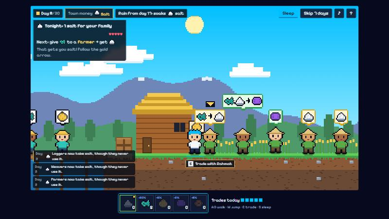
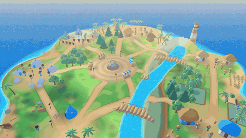

**Play it now, no install, no account: https://mintless-island.vercel.app** (works on a phone) | [Report an issue](https://github.com/Stylenexy/mintless/issues)

# Mintless: the town that picks its own money

In 2016 one Growtopia Diamond Lock sold for Rp100,000. In 2026 it sells for Rp299: savings in a game currency, gone, because someone kept printing.

Mintless is the opposite. You wash up on an island with no coins and a broken boat. 40 villagers barter salt, fish, rice, cloth and wood, and within days they all start taking one good: money, born on its own. You save it for your boat. Then a storm rots it, the town moves on to cloth, and your savings stop being money overnight. Nobody decided that, and nobody, including the developer, can print a single extra unit. The town did it, and reading the town could have saved you.

NEAR Hackathon 2026 · track **Games With Real Economies** · testnet only · no real money, no betting.
Also by the same builder: **RSVPay** (Amplop Balas, track *NFTs That Do Something*, https://rsvpay.vercel.app), a separate project with separate code. It is named here because the rules ask each README to name the other.



*A village in third person. Green bubbles show who can swap with you right now. The camera glides out to a 3/4 view on the road and down to first person when you fish.*



## Judges: one command

Needs Node 20 or newer. No install, no keys, no account.

```
npm run judge
```

It runs, in about 15 seconds:

1. `npm test`: 70 checks over 500 Salt Towns and 760 mystery towns (determinism, money emerges, one rule change switches it, controls, player rules, newcomer guidance, daily islands, local rankings and the offline bundle).
2. `npm run proof`: prints one town day by day, then the same claims measured over 500 seeds.
3. `npm run verify:chain`: reads the live testnet contract (read-only) and checks it has zero access keys, that its rules hash equals `rules/town.js`, and that its current state equals what your local engine computes for the same day. Offline, this step prints `SKIPPED` instead of failing.

Expected output (abridged):

```
✔ salt becomes money by day 14 in every one of 500 towns
✔ one rule change (salt turns damp on day 16) makes cloth the money within 7 days
✔ if every good spoils alike, the town still picks a money, and history decides which
✔ pure barter feeds nobody; money feeds the town
  first money by good: 160 / 120 / 140 / 180 / 160; slowest-spoiling good won 50%
ℹ pass 70  ℹ fail 0
  salt became money in 500/500 towns, median day 3, latest day 11
  after the rain, cloth replaced it in 500/500 towns, median 3 days, slowest 6
PASS | access keys on the contract account: 0
PASS | rules hash on chain = sha256(rules/town.js)
PASS | day 30: chain fingerprint 172d8ea0 = local engine replay; money = cloth
```

To play: `npm start`, then open http://localhost:5173 (a season of 10 days takes about 15 minutes, on a laptop or a phone). In a hurry? Open http://localhost:5173/?demo and press *Jump to the storm*: it puts you on day 6 with savings in hand, about 30 seconds before they stop being money. No Node? `npm run bundle` writes `dist/mintless.html`, one file that opens in any browser. The dashboard with the rules, the what-if switches and the live chain proof is at http://localhost:5173/web/lab.html.

**Daily island:** after your first sail, the title screen also offers *Daily island* (the same island for everyone, seeded from the UTC date, full prices, ten days) and *Mystery island*. A local top ten per date is kept in this browser only: no server, no shared scores, and it can be edited.

## Why this exists

In 2016 one Diamond Lock, the currency of the sandbox MMO Growtopia, sold for about Rp100,000 in Indonesia. In June 2026 the cheapest listing was Rp299: down 99.7%, while Indonesian consumer prices rose 28.5% over the same years. The game kept minting currency (locks bought with gems, gem packs sold and raised almost every year), and players who saved in it lost almost everything. I grew up trading in that economy.

Price points (lowest seller listings): Dec 2015 Rp185,000 · Dec 2016 Rp100,000 · Sep 2017 Rp45,000 · Dec 2019 Rp26,000 · Nov 2021 Rp10,000 · Sep 2023 Rp4,000 · Nov 2025 Rp501 · Jun 2026 Rp299. Sources: seller blog comments 2015–2018, itemku listings 2019–2026 via archive.org snapshots, CPI from the World Bank (FP.CPI.TOTL). Rp299 is the cheapest listing of that month; other sellers ask more (one price list claimed Rp5,000, which we could not verify). Even at Rp5,000 the fall is 95%.

Mintless asks the opposite question: what does a game economy look like when nobody can print, and the money is whatever the players and traders actually accept?

What a blockchain fixes here, honestly: the rules and the supply cannot be changed quietly, and there is no one left who can mint. What it does not fix: bots. This repo makes no claim about bots.

## How money emerges (no LLM, no hard-coded currency)

The whole economy is one readable file: [`rules/town.js`](rules/town.js).

- Five roles with eight traders each. Every role makes one good and needs another, and the needs form a ring (the fisher needs salt, the saltmaker needs wood, ...). Two traders never want each other's goods at the same time, so pure barter feeds nobody.
- Each trader keeps a notebook: of the people I met, how many were willing to take each good.
- A trader takes a good she does not need only if `notebook / holding cost` for it beats the good she holds by more than 40%. Holding cost = a base cost + how fast the good spoils.
- Every day each trader meets four random partners (the only randomness, fixed by the town's seed).

Nothing in the engine mentions any good by name (a test checks this). "Money" is only measured afterwards: a good is the town's money when at least 90% of the traders who neither need nor make it would still take it. This is the search model of money from Kiyotaki and Wright (1989), with learning traders in the spirit of Marimon, McGrattan and Sargent (1990). We use simple deterministic traders on purpose: an experiment by Strange Loop Canon (Dec 2025) found that bartering LLM agents did not invent money on their own.

### Evidence (from `npm run judge`)

Every claim, how to check it, and what is not claimed yet: [CLAIMS.md](CLAIMS.md).

| Claim | Result |
|---|---|
| Same seed, same town | identical state hash and history |
| Salt becomes money (spoils 0%/day) | 500 of 500 towns, median day 3, latest day 11 |
| Without a rule change it stays money | 500 of 500 towns through day 60 |
| One rule change: on day 16 salt turns damp (12%/day) | cloth becomes money in 500 of 500 towns, median 3 days later, slowest 6; salt never returns |
| Money follows the rules, not a label | swap salt's and cloth's spoil rates: cloth wins in 500 of 500 |
| Control: every good spoils alike | a money still emerges in 500 of 500, and every good wins somewhere (111 / 97 / 91 / 106 / 95) |
| Money matters | needs met in 30 days: pure barter 0, with emergent money 464 |
| Mystery towns: the rulebook is not the answer | over 760 towns, every good becomes money somewhere (160 / 120 / 140 / 180 / 160) and the slowest-spoiling good wins only 50%; money appears by day 10 in 755 |
| Mystery rain hits the hoard | the rain soaked the money in 744 of 760 towns; a new money followed in 740 of them |

### Salt Town and mystery towns

Salt Town is the tutorial and the proof: its rules are fixed, so the claims above can be checked exactly. The first island you play is Salt Town. Every island after it is a **mystery town**: same traders, same decision rule, but the spoil rates come from one row of a public table in `rules/town.js` (38 shuffles of 1, 2, 3, 8 and 20 percent a day, all checked to be playable by `scripts/mystery-table.js`), and the rains on day 16 soak whatever good most traders hold on day 8. Who makes what and who needs what matters as much as how fast a good spoils, so the winner cannot be read off the rulebook. On day 3 the price leader already points at the eventual money in about 96% of towns: the skill is reading the market early.

## The game loop

Five rounds of testing by one player, the builder, shaped this. A market dashboard was not understood. A 2D town was too crowded, then clear but empty: nothing could be lost. A block world had no goal you could follow. Earlier versions live on at `web/2d/` and `web/v4/`, the dashboard as the lab page.

**Goal: fix four boat parts before the tenth night.** Your first island pays about half and has no deadline, so a first run reaches the sail; every island after that is the full game. Each part is priced in whatever the town accepts most that day, so the same hull costs 4 salt today and 4 cloth after the money moves.

- **Fish.** Walk to a pier and the camera glides into first person. Cast at the ripples, watch the float, strike when it plunges, then pull against the fish with A and D. Skill alone decides the catch; there are no dice. Nine species, one of which only bites in the storm.
- **Swap.** Villagers show what they want and what they give. A green bubble means they can swap with you; press E and the goods fly across. There are no coins and no menus: goods for goods, judged by the same `willTake` rule the villagers use with each other. On day 1 a fish takes four swaps across the island to become salt. By day 3 it takes one. That is what money does.
- **Pay.** The shipwright takes only what the town takes most. Paying burns the units.
- **Survive the money moving.** After day 6 the storm soaks the good people hoard. It rots at 12% a town day, the shipwright stops taking it, and your stack stops buying anything. Spend it or swap it first.
- **Race.** Mira is rebuilding her boat on the far beach with the same rules and the same villagers.

The whole run is about 15 minutes. Your wealth is then drawn next to the Diamond Lock price, and the next island is a mystery: different goods last, so nobody knows what becomes money there.

R rides your duck, on land and across water. M opens the map. C frees the camera. Ctrl + scroll zooms. On a phone: a stick and buttons.

There is no stake, no pool and no real money. Your result depends only on public rules, your skill and your trades.

## On chain (NEAR testnet)

Contract: [`mintless-mvznw81o.testnet`](https://testnet.nearblocks.io/address/mintless-mvznw81o.testnet), source in [`contract/`](contract/) (Rust, near-sdk 5.30).

- The 40 traders live in contract state. `tick(days)` advances the town and **anyone** can call it (10 days cost about 7.1 TGas). A town can also be born with `day_seconds > 0`, so it cannot run ahead of the clock.
- The Rust engine is a step-for-step port of `engine/town.js`. `cargo test` replays fixtures written by the JS engine (3 Salt Towns and 3 mystery towns, 41 days each) and must match the state fingerprint, money and prices every day. On testnet, `fingerprint()` matched the local engine on day 10 and day 30.
- Goods are NEP-245 multi tokens in one contract (`salt`, `fish`, `rice`, `cloth`, `wood`): `mt_transfer`, `mt_batch_transfer`, `mt_balance_of`, `mt_batch_balance_of`, `mt_supply`, `mt_batch_supply`, `mt_token`, with `nep245` events.
- **No mint function exists.** Supply is fixed in `new` (one `mt_mint` event, "genesis: the only mint, ever"). Afterwards goods only move (`join` takes a starter bag from the town chest, `swap` trades with the town stall at on-chain prices) or rot (player stockpiles spoil by the public rules; rot is burned with an `mt_burn` event). Supply can only go down.
- No owner, no admin method, no upgrade method. After deploying, the account's only access key was deleted. `rules()` returns the exact rules text; its sha256 is `rules_hash`.

Testnet run (`tools/chain-report.txt`): rules hash matched, player joined and swapped, 10 days in one call, chain = local engine, key deleted (0 keys left), a stranger then advanced the town to day 30, the rain switched the money to cloth exactly as locally, supply only went down. 10 PASS, 0 FAIL.

Version note: the deployed contract was built from the commit "NEAR contract: town runs on-chain" on 3 November, before mystery towns and the shipwright existed. Salt Town behaves the same in both versions, which is why its on-chain fingerprint still matches today's engine.

### The shipwright on chain: built, not live yet

The next deploy moves the game's core rule into the contract. `build(part, town_day, good)` recomputes the town from its seed and rules up to that morning, finds the good the town accepts most, refuses anything else, and burns the price from the caller's on-chain bag. So what counts as money on day 7 is decided by the contract, not by the browser.

The browser side is in `web/chain-play.js`: a guest account made by the testnet helper, a key in localStorage, each boat part signed with the browser's own WebCrypto, no wallet and no popup, and a receipt per part on the end screen. Payments never block the game.

What has been proved so far: the signer matches `near-api-js` byte for byte (`test/chain-play.test.js`), and the live testnet RPC parsed a transaction from it and answered `SignerDoesNotExist`, as it should for an account that does not exist. The compiled contract passes `npm run check:wasm` (15 checks in a stand-in NEAR host, including refusing salt on day 7). What has not: no guest has paid on testnet yet, because the testnet account helper is rate limiting this machine (HTTP 429). Until the redeploy the game stays local, and when the helper says no it says so on the end screen.

Not implemented on purpose: NEP-245 approvals and `*_transfer_call`. Transfers go only to accounts that joined (keeps storage bounded; the contract pays storage).

## Track checklist (Games With Real Economies)

| Track ask | Here |
|---|---|
| Economy is the gameplay, evolves without a dev patch | the money is chosen by the traders and changes when a public rule changes; no admin key exists to patch it |
| Items as NEP-245 multi tokens in one contract | yes, five goods in `mintless-mvznw81o.testnet` |
| Merchant rules in one readable file, with reasoning | `rules/town.js`; villagers say why they refuse, from the same rule |
| Fast-forward mode | every night the town runs three days; `tick(days)` on chain (10 days per call) |
| Loop designed on paper first | see "The game loop" above |
| Social login, no wallet popups | no login at all: a guest account and in-browser signing are built (`web/chain-play.js`) but not live yet, see "The shipwright on chain"; today the browser game plays locally |
| Judged on the loop, not the token | there is no token to buy; goods only exist inside the town |

## Built during the hackathon

All code in this repository was written from 3 November 2026 on, during the event (1–14 Nov). The git history shows the order: engine and tests first, then the browser game, then the contract and the testnet run.

## Honest limits

- The browser game runs the same engine locally; the testnet town is the verifiable copy. Fishing and barter with villagers stay in the browser even after the redeploy: the chain can prove what the shipyard accepted and burned, not that you caught the fish. Your on-chain bag is a fixed starter bag (32 of each good, from a chest that never refills), separate from the bag on screen.
- The town does not react to the player: your swaps last until dusk, then every trader goes back to what they held at dawn. That keeps the town's path a pure function of rules and seed, which is what lets the contract recompute it. The town stall is the only market on chain. The stall's own stock does not spoil.
- Prices are the traders' average notebook values (1 to 100), a measure of tradeability, not a market-clearing price.
- Testnet only, not audited, one town with five goods by design.
- Prior art: the browser game *WTH Is Money?* (loathwine, Oct 2026) teaches the same idea with a village barter market; it is not on chain. Agent-based emergence of money is classic research (Marimon, McGrattan and Sargent 1990). What is new here is a playable town where the emergence runs inside a contract nobody controls.

## Repo map

```
rules/town.js        the only file that sets the economy (goods, roles, trader rule, calendar, mystery table)
engine/town.js       the town (pure, integer-only, deterministic)
engine/visitor.js    the player as trader 41: offers judged by the traders' own rule, shortest swap chain
engine/island.js     one run: the boat, the shipyard, the catch, nights (engine/homestead.js only serves the v4 archive)
engine/player.js     bag spoilage and prices (used by the visitor and the lab page)
engine/mystery.js    builds a mystery town's rules from its seed
test/                node:test checks over 500 Salt Towns and 760 mystery towns
scripts/proof.js     prints the evidence tables
scripts/mystery-table.js   finds the playable rows of the mystery table
scripts/bundle.js    builds dist/mintless.html (the game) and dist/mintless-lab.html, one file each
scripts/verify-chain.js   read-only check of the testnet town
web/                 the game (game.js; kit.js = toon look, island3d.js = the island, people.js = everyone in it, audio.js = synthesized sound), the lab page (lab.html), earlier versions (2d/, v4/), Three.js (vendor/)
contract/            NEAR contract (Rust) + parity fixtures
tools/chain.mjs      deploy to testnet with throwaway accounts, play, delete the last key
tools/wasm-check.mjs runs the compiled contract in a stand-in NEAR host, no network
```

Contract work (needs Rust and the `wasm32-unknown-unknown` target; on Windows set `AWS_LC_SYS_PREBUILT_NASM=1`):

```
npm run test:contract      # 15 Rust tests, including JS/Rust parity for Salt Town and mystery towns
npm run build:contract
npm run check:wasm           # the real wasm, the shipwright's rules, no network
npm run deploy:testnet     # new throwaway town, played and locked; add -- --keep to lock it live later
```

## Tools and libraries

- Engine, tests and scripts: plain JavaScript on Node.js built-ins, no npm dependencies. 3D rendering: Three.js r160, vendored in `web/vendor/`.
- Contract: Rust with `near-sdk` 5.30.0. Deploy tool only: `near-api-js` 7.4.0. The browser signs with WebCrypto, no library. RPC: FastNEAR's public testnet endpoint (0.3 s per call from here, against 3.2 s for `rpc.testnet.near.org`).
- Fonts: Lilita One and Baloo 2 (game); Fraunces, Nunito, JetBrains Mono (lab page), all from Google Fonts. All terrain, 3D characters, goods, music and sound are made in code. The fish cards and two portraits in `web/art.js` were made with an image generator (OpenAI Codex image tool) from our own prompts.
- AI: code and documentation were written with AI coding assistants (Claude Code; OpenCode drafted `web/audio.js`), listed here as the hackathon rules ask. The engine and chain claims in this README are checked by the commands above; the Growtopia prices come from the sources listed.

## Team

Dex Bennett (solo), Information Systems student, Universitas Kristen Duta Wacana, Yogyakarta.

## License

MIT, see [LICENSE](LICENSE).
